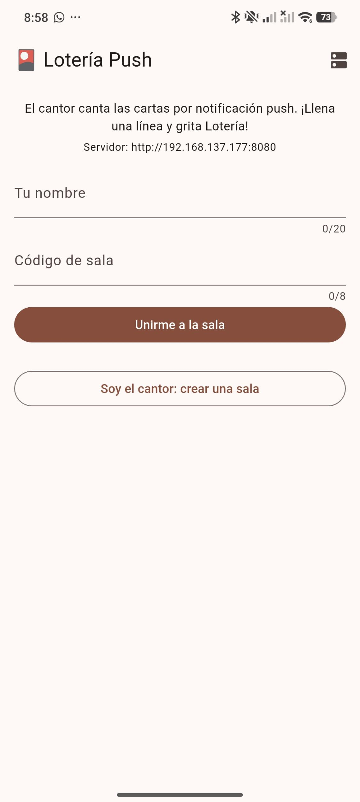
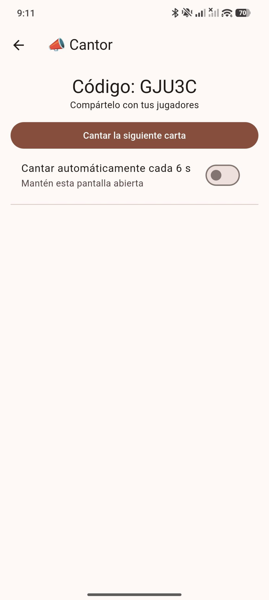
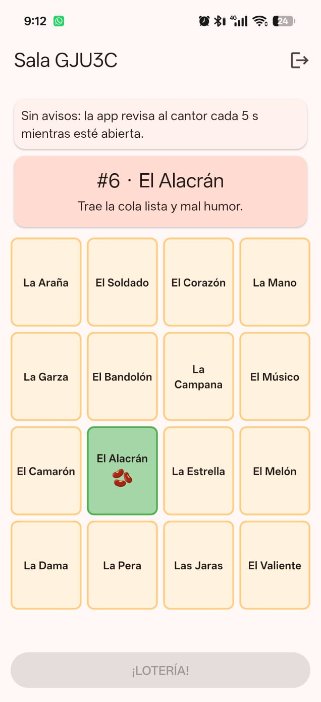

# Lotería Push

Juego de lotería mexicana para Android. El cantor corre en un servidor: cada vez que canta una carta, les llega a
todos los jugadores de la sala. Si a un jugador le falta una sola carta para ganar, recibe un aviso de "¡Casi!", y
cuando alguien grita Lotería el servidor revisa que de verdad haya ganado.

La app no depende solo de las notificaciones: si se pierde alguna, le pregunta al servidor y se pone al día.

Las cartas "El Taco" y "El Elote" se usaron en lugar de dos cartas con nombres ofensivos.

## APK

| Archivo | Ruta |
|---|---|
| Lista para instalar | apk/LoteriaPush.apk (18.2 MB) |
| Salida de Flutter | build/app/outputs/flutter-apk/app-release.apk |

Para compilarla:

```bash
flutter build apk --release --target-platform android-arm64
```

El APK funciona en teléfonos arm64 (casi todos los Android recientes). Para instalarlo, copia el archivo .apk al
teléfono, ábrelo y permite instalar apps de origen desconocido.

### Sin Firebase

Este APK se compiló sin google-services.json, así que no usa notificaciones push. En su lugar, la app le pregunta
al cantor cada 5 segundos si hay cartas nuevas. Para activar las notificaciones:

1. Crea un proyecto en la consola de Firebase y registra la app Android mx.edu.utng.loteria_push.
2. Copia google-services.json a app/android/app/ y agrega el plugin com.google.gms.google-services.
3. En el servidor instala firebase-admin, define la variable GOOGLE_APPLICATION_CREDENTIALS y arranca con FCM_REAL=1 npm start.

En la app, toca el botón del servidor para escribir la dirección del cantor (http://IP-DE-TU-PC:8080). El celular y
la computadora deben estar conectados a la misma red Wi-Fi.

## Estructura del código

El proyecto tiene dos carpetas principales:

- server: el servidor del cantor, hecho en Node.
  - baraja.js, lineas.js, mensajes.js, sala.js, enviador.js y servidor.js
  - test: pruebas del servidor
- app: la aplicación en Flutter.
  - lib/dominio: las reglas del juego (cartas, tablas, cuándo se gana).
  - lib/infra: la conexión con Firebase, el servidor y el almacenamiento del teléfono.
  - lib/presentacion: las pantallas de la app (inicio, juego y cantor).
  - test: pruebas de la app

## Servidor

Desde la carpeta server:

```bash
npm install
npm start
```

El servidor queda escuchando en el puerto 8080. Si no está configurado Firebase, las notificaciones se muestran en la
consola en lugar de enviarse.

Lo que hace el servidor:

- Crea salas con un código de 5 letras.
- Reparte una tabla de 16 cartas a cada jugador.
- Canta las cartas en orden aleatorio y no deja cantar dos seguidas en menos de 2 segundos.
- Revisa que quien canta Lotería tenga la línea completa.
- Borra los tokens de teléfonos que ya no existen.

## Capturas de la app

Tomadas en un teléfono con el APK instalado.

| Inicio (unirse a una sala) | Pantalla del cantor | Tabla con frijolitos |
|---|---|---|
|  |  |  |

| Te falta una carta | Lotería (ganador) | Sin conexión con el cantor |
|---|---|---|
|  |  |  |

## Pruebas rápidas en la app

| Caso | Qué hacer | Resultado esperado |
|---|---|---|
| Cantor | Teléfono A: "Soy el cantor" y luego "Crear sala" | Aparece el código de la sala (ej. K7M2P) |
| Jugador | Teléfono B: escribir nombre y código, luego "Unirme" | Aparece la tabla de 16 cartas |
| Cantar | Teléfono A: "Cantar la siguiente carta" | En B aparece la carta y su frijolito (máximo 5 s sin push) |
| Freno | Cantar dos veces muy rápido | Sale el mensaje "Canta más despacio" |
| Lotería | Completar una fila y tocar LOTERÍA | Sale "¡Ganaste!" (lo confirma el servidor) |
| Sin servidor | Apagar el cantor | Sale en rojo "No se pudo contactar al cantor" |

## Cómo correr el proyecto

```bash
flutter pub get
flutter run
```
