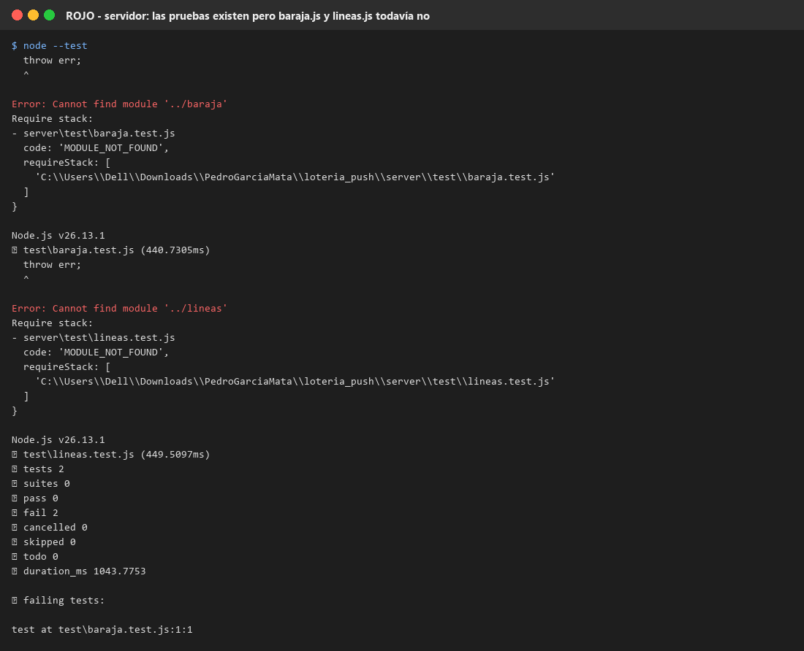
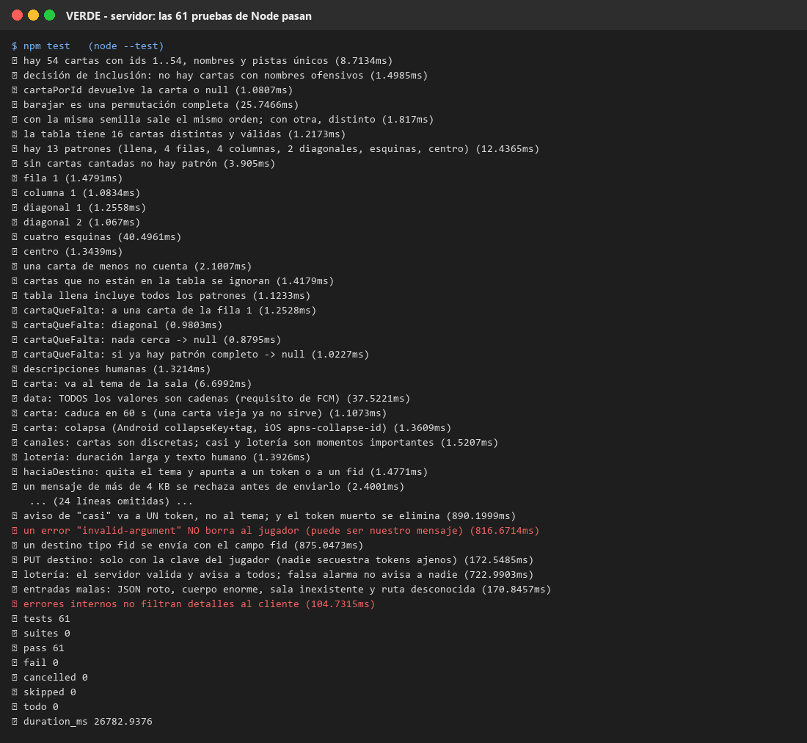
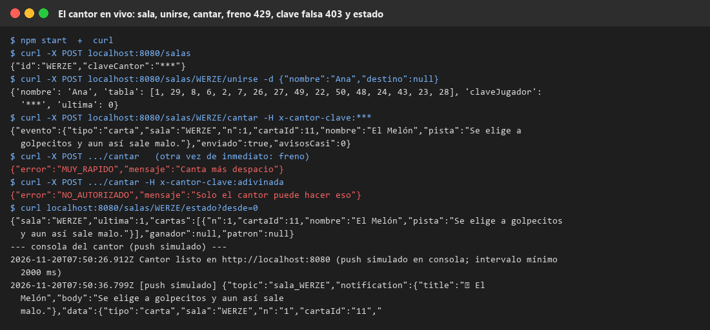
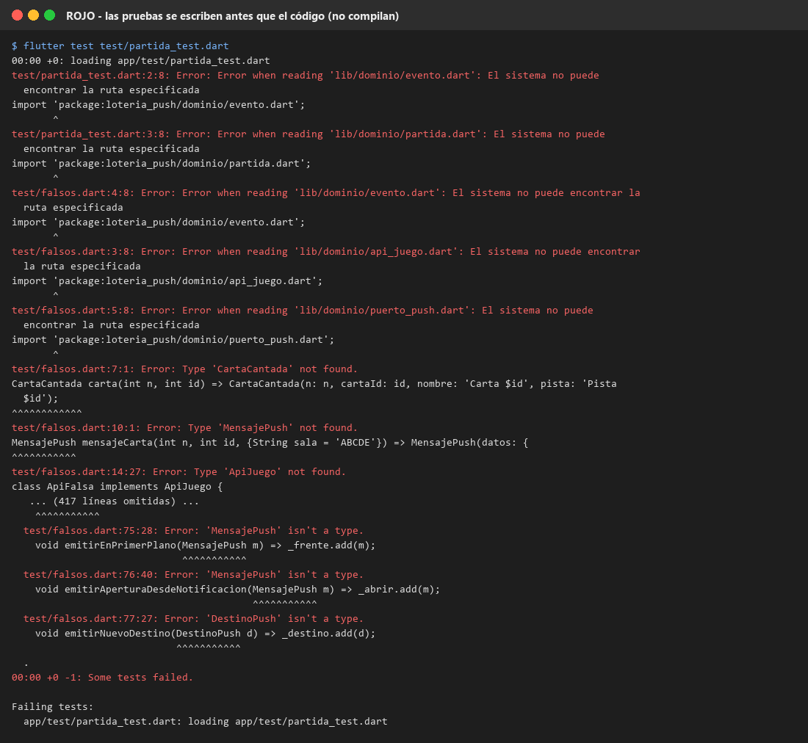
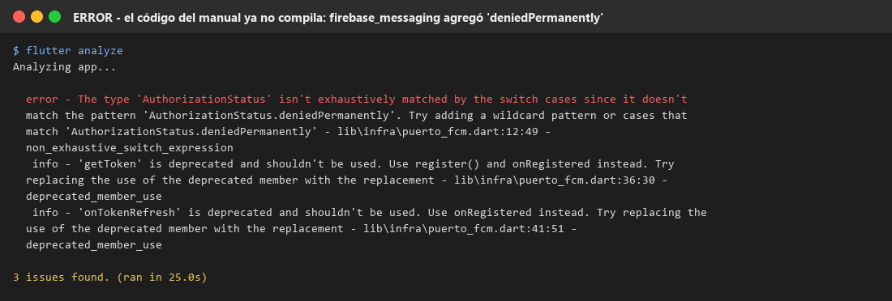
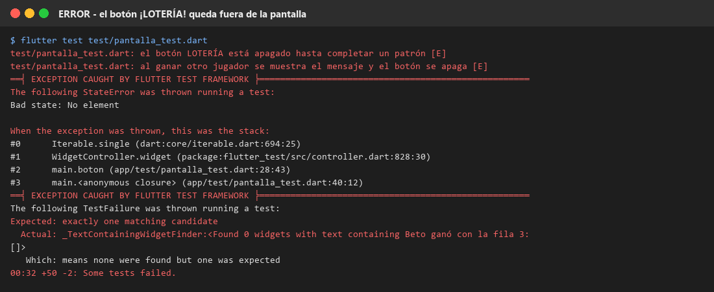
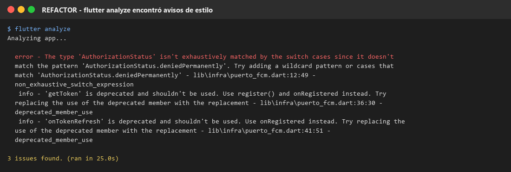
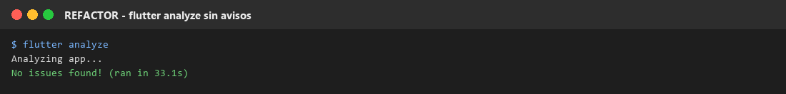
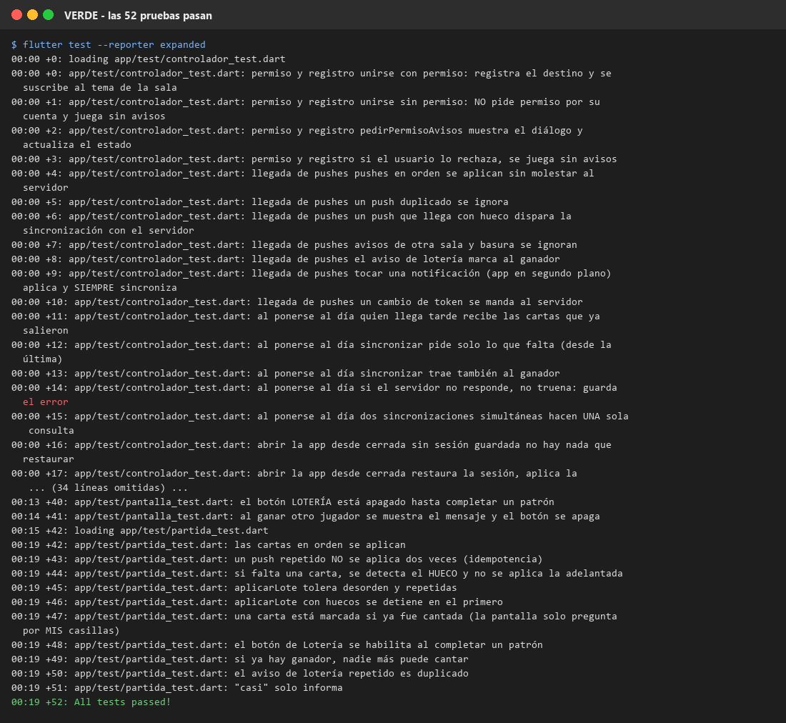
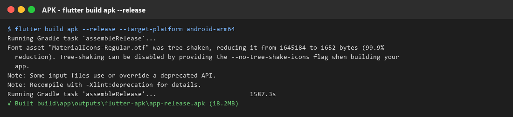

# Lotería Push — notificaciones push con un cantor en la nube (TDD)

Lotería mexicana donde **el cantor vive en un servidor**: cada carta llega como notificación push a todos los
jugadores de la sala, quien está a una carta de ganar recibe un "¡Casi!" personal y el servidor valida quién canta
Lotería. Construida con **TDD** siguiendo el *Manual paso a paso con TDD — Lotería Push*: servidor Node con 61
pruebas, mensajes FCM correctos (datos como texto, TTL, colapso, canales, 4 KB), higiene de tokens, y una app que
trata el push como **aviso** y al servidor como **verdad** (idempotente, detecta huecos y se pone al día).

**Decisión de inclusión del manual:** "El Taco" y "El Elote" sustituyen a dos cartas con nombres ofensivos.

---

## 📦 APK

| Archivo | Ruta |
|---|---|
| Lista para instalar | `apk/LoteriaPush.apk` (18.2 MB) |
| Salida de Flutter | `build/app/outputs/flutter-apk/app-release.apk` |

```bash
flutter build apk --release --target-platform android-arm64
```

El APK es para teléfonos **arm64** (prácticamente todos los Android de los últimos años). Para instalar: copia el `.apk` al teléfono, ábrelo y acepta *instalar apps de origen desconocido*.

**Sin Firebase también funciona.** Este APK se compiló sin `google-services.json` (eso requiere un proyecto de
Firebase con tu cuenta de Google): la app detecta que no hay Firebase y juega **consultando al cantor cada 5 s**, que
es la "degradación elegante" que pide el manual. Para activar el push real:

1. Crea el proyecto en la consola de Firebase y registra la app Android `mx.edu.utng.loteria_push`.
2. Copia `google-services.json` a `app/android/app/` y agrega el plugin `com.google.gms.google-services`.
3. En el servidor: `npm install firebase-admin`, variable `GOOGLE_APPLICATION_CREDENTIALS` y `FCM_REAL=1 npm start`.

En la app toca 🗄️ para escribir la dirección del cantor (`http://IP-DE-TU-PC:8080`); el celular y la PC deben estar
en la misma red Wi-Fi.

---

## 🏗️ Estructura

```
loteria_push/
├── server/                    el cantor (Node, sin dependencias para las pruebas)
│   ├── baraja.js lineas.js mensajes.js sala.js enviador.js servidor.js
│   └── test/  baraja · lineas · mensajes · sala · servidor (de punta a punta con fetch)
└── app/
    ├── lib/dominio/       evento · lineas · cartas · partida · api_juego · puerto_push · almacen · sesion · controlador
    ├── lib/infra/         puerto_fcm · puerto_sin_push (sin Firebase) · fondo · canales_android · api_http · almacen_prefs
    ├── lib/presentacion/  vms · pantalla_inicio · pantalla_juego · pantalla_cantor
    └── test/              falsos · evento_lineas · partida · controlador · pantalla
```

---

## 🖥️ Servidor

```bash
cd ../server
npm test
```

```bash
npm start
```

**ROJO del servidor** (pruebas escritas antes que `baraja.js` y `lineas.js`):



**VERDE del servidor: 61 pruebas** (baraja, líneas, mensajes FCM, sala con autorización y trampas, HTTP de punta a punta):



**El cantor en vivo** con `curl`: crear sala, unirse, cantar, freno 429 si se canta muy rápido, 403 con clave falsa y
estado "desde n" (el push aparece simulado en la consola):



---

## 🔴🟢🔵 Evidencia del ciclo TDD

### 1. 🔴 ROJO — las pruebas se escriben primero y fallan

Las pruebas de `test/` se escribieron **antes** que el código. Al correr `flutter test` con `lib/` todavía vacía, nada compila:



### 2. ❌ Error real atrapado por una prueba

El error que el propio manual cuenta que encontró **solo al probar contra un servidor real**: al rechazar un cuerpo
de más de 2 KB, la primera versión cortaba la conexión:

```js
if (total > MAX_CUERPO) {
  req.destroy();                       // ❌ el cliente ve "fetch failed", no el 413
```

La prueba *"entradas malas: JSON roto, cuerpo enorme…"* levanta el servidor, le manda 5 KB y falló con
`SocketError: other side closed` (60 de 61 en verde):

*(captura pendiente: `capturas/../capturas/02_error_413_socket.png`)*

**Corrección:** dejar de acumular, descartar el resto y responder 413 con `connection: close`:

```js
req.removeAllListeners('data');
req.resume();                          // ✅ el cliente sí alcanza a leer el 413
reject(new ErrorJuego('CUERPO_GRANDE', 'Cuerpo demasiado grande', 413));
```

#### Segundo error: el código del manual ya no compila

El manual advierte que su código Dart no se ejecutó al escribirlo y que Firebase cambia rápido. Efectivamente:
`firebase_messaging` agregó el estado `AuthorizationStatus.deniedPermanently` y el `switch` del manual dejó de ser
exhaustivo (**error de compilación**). `flutter analyze` lo detectó antes de compilar el APK:



**Corrección** (solo en `lib/infra/puerto_fcm.dart`, el único archivo que conoce Firebase, tal como el manual lo planeó):

```dart
AuthorizationStatus.denied || AuthorizationStatus.deniedPermanently => PermisoPush.denegado,   // ✅
```

#### Tercer error: el botón ¡LOTERÍA! quedaba fuera de la pantalla

En la corrida completa antes de compilar el APK fallaron 2 pruebas de pantalla: no encontraban el botón ni el
mensaje del ganador. La tabla de 4×4 mide más que la pantalla y el botón estaba **al final del `ListView`**, que
solo construye lo visible: en el teléfono habría que hacer scroll para cantar lotería, justo cuando hay prisa.



**Corrección:** el aviso del ganador, el "¡casi!", el botón y los mensajes pasaron a un
`bottomNavigationBar` fijo, siempre visibles, y las pruebas volvieron a verde.

### 3. 🔵 REFACTOR — limpiar sin romper nada

`flutter analyze` señaló avisos de estilo:



Se corrigieron y se volvió a analizar:



### 4. 🟢 VERDE — las 52 pruebas pasan



### 5. 📦 Compilación del APK



---

## ✅ Qué cubren las pruebas

| Grupo | Lo que se verifica |
|---|---|
| Servidor: baraja | 54 cartas únicas, inclusión (Taco y Elote), Fisher-Yates con semilla, tabla de 16 |
| Servidor: mensajes | data solo texto, TTL 60 s / 5 min / 1 h, colapso, canales, destino token/fid, límite 4 KB |
| Servidor: sala | nombres válidos (acentos sí, `<script>` no), sala llena, freno 2 s, mazo secreto, claves de cantor y jugador, ganador validado, "¡casi!" una vez |
| Servidor: HTTP | flujo completo, 403, 429, estado desde n, FCM caído no rompe el canto, token muerto se elimina, invalid-argument no, errores sin filtrar secretos |
| App: eventos | todo llega como texto, rangos, tipos desconocidos, sala, mismos patrones que el servidor |
| App: partida | idempotencia, huecos, lote desordenado, marcar casillas, botón Lotería, ganador |
| App: controlador | permiso solo en contexto, sin permiso juega igual, hueco → sincroniza, otra sala o basura, token nuevo, restaurar desde cerrada, una sola consulta simultánea |

```bash
flutter test
```

---

## 📱 Capturas de la app

> Tomadas en un teléfono físico con el APK instalado. *Guarda tus capturas en `capturas/` con estos nombres y aparecerán aquí automáticamente.*

| Inicio (unirse a una sala) | Pantalla del cantor | Tabla con frijolitos |
|---|---|---|
|  |  |  |

| ¡Estás a una carta! | ¡Lotería! (ganador) | Error: sin conexión con el cantor |
|---|---|---|
|  |  |  |

### Qué probar en la app

| Caso | Qué hacer | Resultado esperado |
|---|---|---|
| Cantor | Teléfono A: "Soy el cantor" → Crear sala | Muestra el código (ej. `K7M2P`) |
| Jugador | Teléfono B: nombre + código → Unirme | Aparece la tabla de 16 cartas |
| Cantar | Teléfono A: "Cantar la siguiente carta" | En B aparece la carta y su frijolito (≤ 5 s sin push) |
| Freno | Cantar dos veces muy rápido | "Canta más despacio" |
| Lotería | Completa una fila y toca ¡LOTERÍA! | "¡Ganaste! 🎉" (el servidor lo valida) |
| Sin servidor | Apaga el cantor | Mensaje rojo: "No se pudo contactar al cantor" |

---

## 🛠️ Cómo correr el proyecto

```bash
flutter pub get
```

```bash
flutter test
```

```bash
flutter run
```

